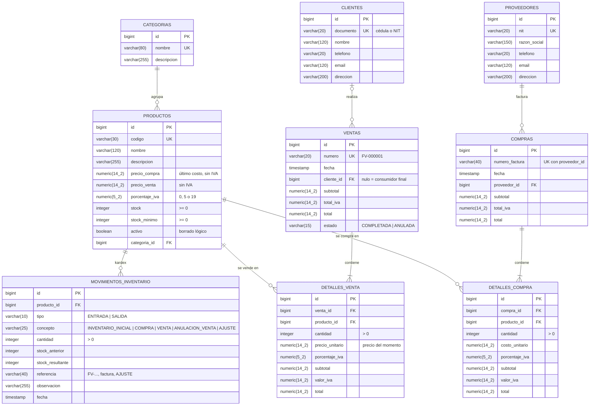

# Modelo de datos

Fuente de verdad del esquema: la migración [`supabase/migrations/20261121000000_esquema_inicial.sql`](../../supabase/migrations/20261121000000_esquema_inicial.sql) (producción, PostgreSQL en Supabase, esquema `minierp`). En desarrollo, Hibernate genera las mismas tablas en H2 a partir de las entidades de `com.minierp.entity`.

## Diagrama entidad-relación

## Tablas

| Tabla | Propósito | Claves e índices |
|---|---|---|
| `categorias` | Agrupa productos | `nombre` único |
| `productos` | Catálogo con precios, IVA y stock actual | `codigo` único · FK `categoria_id` |
| `clientes` | Compradores identificados | `documento` único |
| `proveedores` | Quienes nos facturan | `nit` único |
| `ventas` | Cabecera de la factura de venta | `numero` único · FK `cliente_id` (opcional) |
| `detalles_venta` | Renglones de la venta, con el precio congelado | FK `venta_id`, `producto_id` |
| `compras` | Factura recibida de un proveedor | único (`proveedor_id`, `numero_factura`) |
| `detalles_compra` | Renglones de la compra | FK `compra_id`, `producto_id` |
| `movimientos_inventario` | Kardex: cada cambio de stock con su saldo antes y después | FK `producto_id` · índice (`producto_id`, `fecha`) |

Montos en `numeric(14,2)`, redondeo `HALF_UP` a 2 decimales (`util/Montos`). Fechas en hora local del servidor (`America/Bogota`).

## Reglas de negocio y capa responsable

Capas: **BD** = restricción en PostgreSQL (migración) · **Servicio** = `com.minierp.service` · **DTO** = Bean Validation en `*Request` · **Repositorio** = consulta/bloqueo en `com.minierp.repository` · **Front** = solo experiencia de usuario, nunca la única barrera.

| # | Regla | Capa principal | Refuerzo |
|---|---|---|---|
| R1 | El stock solo cambia por inventario inicial, compra, venta, anulación o ajuste, y cada cambio deja un movimiento en el kardex | Servicio (`InventarioService`, transacción `MANDATORY`) | BD: RLS impide escribir desde la API pública de Supabase |
| R2 | El stock nunca queda negativo | Servicio (`InventarioService.registrarSalida` → 422) | BD: `check (stock >= 0)` |
| R3 | Una venta es atómica: si un producto falla, no se descuenta nada | Servicio (`@Transactional` en `VentaService.registrar`) | — |
| R4 | Dos ventas simultáneas no pueden vender la misma unidad | Repositorio (`findByIdParaActualizar`, `SELECT … FOR UPDATE`) | Servicio: productos en orden de id para evitar deadlocks |
| R5 | Precios, IVA y totales los calcula el backend; el cliente solo envía `productoId` y `cantidad` (y el costo en compras) | DTO (`VentaRequest` sin precios) + Servicio | — |
| R6 | El detalle conserva el precio y el IVA del momento | Servicio (copia a `DetalleVenta`/`DetalleCompra`) | — |
| R7 | Una venta anulada devuelve sus unidades y no se puede anular dos veces | Servicio (`VentaService.anular`, venta bloqueada con `FOR UPDATE`) | BD: `check (estado in (...))` |
| R8 | No se vende un producto inactivo | Servicio (`VentaService.registrar` → 422) | Front: el buscador solo muestra activos |
| R9 | Cada compra suma stock y actualiza el último costo (`precio_compra`) | Servicio (`CompraService.registrar`) | — |
| R10 | Un proveedor no puede repetir número de factura | Servicio (→ 409) | BD: `unique (proveedor_id, numero_factura)` |
| R11 | Un producto no puede repetirse en la misma compra | Servicio (→ 422) | — |
| R12 | El precio de venta no puede ser menor al de compra | Servicio (`ProductoService.validarPrecios` → 422) | BD: `check (precio_venta >= precio_compra)` no se aplica porque una compra puede subir el costo por encima del precio de venta vigente |
| R13 | Código de producto, nombre de categoría, documento de cliente y NIT son únicos | Servicio (→ 409, sin distinguir mayúsculas en código y categoría) | BD: `unique` |
| R14 | Los productos no se borran, se desactivan | Servicio (`ProductoService.desactivar`) | BD: FK sin `on delete cascade` |
| R15 | No se eliminan categorías, clientes ni proveedores con registros asociados | Servicio (→ 409) | BD: FK `on delete restrict` |
| R16 | Cantidades positivas y acotadas; IVA entre 0 y 100; precios > 0 | DTO (`@Positive`, `@Max`, `@DecimalMin/Max`) | BD: `check` equivalentes |
| R17 | Venta sin cliente = consumidor final (documento 222222222222 en la factura) | Servicio/DTO (`VentaResponse`) | Front (factura imprimible) |
| R18 | Los datos solo son accesibles a través de la API de Spring Boot | BD (RLS activo sin políticas para `anon`/`authenticated`, esquema no expuesto) | Infra: credenciales solo en variables de entorno de Render |
