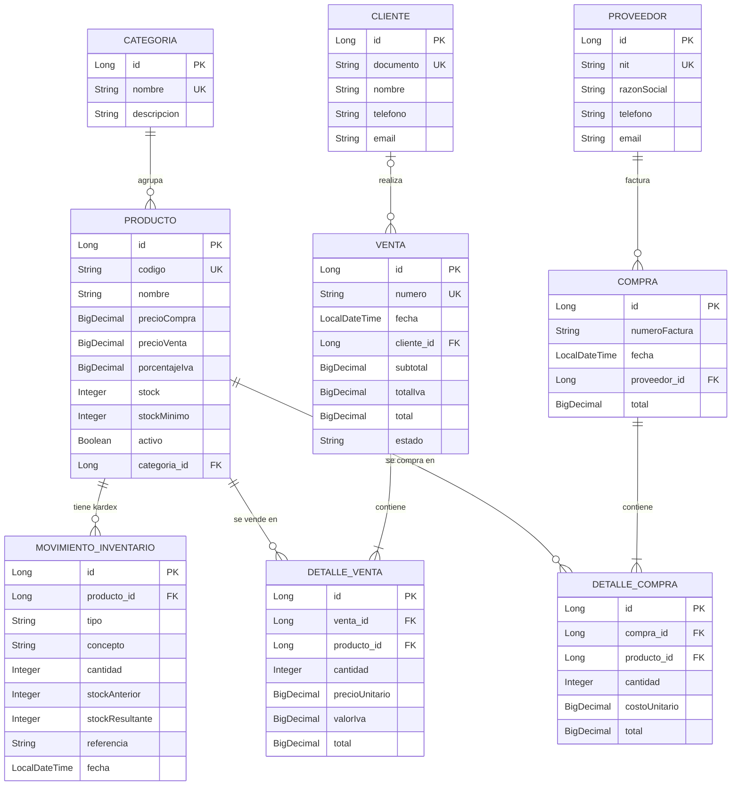

# Mini-ERP · Inventario y facturación

Proyecto integrador del Diplomado de Desarrollo Web Full Stack.

| Capa | Tecnología |
|---|---|
| Backend | Java 17 · Spring Boot 3.3 · Spring Data JPA · Bean Validation · springdoc (Swagger) |
| Base de datos | MySQL 8 |
| Frontend | Next.js 15 (App Router) · React 19 · TypeScript · Tailwind CSS 4 · Recharts |

```
minierp/
├── backend/            API REST (puerto 8080)
├── frontend/           Aplicación web (puerto 3000)
└── docker-compose.yml  MySQL opcional con Docker
```

---

## 1. Cómo ejecutarlo

### Requisitos
- JDK 17 o superior, Maven (o el de tu IDE: IntelliJ, VS Code o STS)
- Node.js 20 o superior
- MySQL 8 (instalado, XAMPP/Laragon, o `docker compose up -d`)

### Backend
1. Revisa usuario y contraseña de MySQL en `backend/src/main/resources/application.properties`.
2. Ejecuta:
   ```bash
   cd backend
   mvn spring-boot:run
   ```
3. La base `minierp` y las tablas se crean solas. La primera vez se cargan **datos de ejemplo** (categorías, 10 productos, clientes, proveedores y 3 ventas).
4. Documentación interactiva de la API: **http://localhost:8080/swagger-ui.html**

### Frontend
```bash
cd frontend
cp .env.local.example .env.local
npm install
npm run dev
```
Abre **http://localhost:3000**

---

## 2. Modelo de datos



> GitHub y VS Code (con extensión Mermaid) dibujan este diagrama automáticamente.

---

## 3. Reglas de negocio implementadas

| Regla | Dónde |
|---|---|
| El stock **solo** cambia por ventas, compras, anulaciones o ajustes, y cada cambio queda en el kardex | `InventarioService` |
| Una venta es atómica: si un producto no tiene stock, no se descuenta nada (`@Transactional`) | `VentaService.registrar` |
| Bloqueo pesimista (`SELECT … FOR UPDATE`) para que dos ventas simultáneas no vendan el mismo stock | `ProductoRepository.findByIdParaActualizar` |
| Los productos se procesan ordenados por id para evitar deadlocks | `VentaService`, `CompraService` |
| Los precios e IVA los calcula el backend; el frontend solo envía producto y cantidad | `VentaRequest` |
| El detalle guarda el precio del momento (si el producto cambia de precio, la factura no cambia) | `DetalleVenta` |
| Anular una venta devuelve las unidades al inventario | `VentaService.anular` |
| Cada compra suma stock y actualiza el último costo del producto | `CompraService` |
| No se repite una factura del mismo proveedor | `CompraService` + restricción única |
| El precio de venta no puede ser menor al de compra | `ProductoService` |
| Borrado lógico de productos (pueden estar en facturas) | `ProductoService.desactivar` |
| No se eliminan categorías, clientes ni proveedores en uso | Servicios respectivos |
| IVA colombiano (0 %, 5 %, 19 %) y consumidor final con documento 222222222222 | `ProductoForm`, `VentaResponse` |

---

## 4. Endpoints principales

| Método | Ruta | Descripción |
|---|---|---|
| GET | `/api/dashboard` | Indicadores, ventas de 7 días, top productos, alertas |
| GET | `/api/productos?buscar=&categoriaId=&stockBajo=&page=&size=&sort=` | Listado con filtros y paginación |
| POST / PUT | `/api/productos`, `/api/productos/{id}` | Crear / editar |
| DELETE | `/api/productos/{id}` | Desactivar (borrado lógico) |
| PATCH | `/api/productos/{id}/activar` | Reactivar |
| GET | `/api/productos/{id}/kardex` | Historial de movimientos |
| POST | `/api/productos/{id}/ajustes` | Ajuste manual de inventario |
| GET / POST | `/api/ventas` | Listar (filtro `desde`, `hasta`) / registrar venta |
| GET | `/api/ventas/{id}` | Factura con detalle |
| PATCH | `/api/ventas/{id}/anular` | Anular y devolver stock |
| GET / POST | `/api/compras` | Listar / registrar compra |
| CRUD | `/api/categorias`, `/api/clientes`, `/api/proveedores` | Catálogos |

Ejemplo para registrar una venta:
```json
POST /api/ventas
{
  "clienteId": 1,
  "items": [
    { "productoId": 1, "cantidad": 3 },
    { "productoId": 5, "cantidad": 2 }
  ]
}
```

Todos los errores llegan con el mismo formato:
```json
{
  "status": 422,
  "error": "Unprocessable Entity",
  "mensaje": "Stock insuficiente para 'Azúcar 1 kg': disponible 6, solicitado 10",
  "ruta": "/api/ventas"
}
```
Los errores de validación incluyen además `"errores": { "campo": "mensaje" }`, que el frontend muestra debajo de cada input.

---

## 5. Pantallas del frontend

| Ruta | Pantalla |
|---|---|
| `/` | Dashboard con indicadores y gráfica |
| `/ventas/nueva` | Punto de venta (buscador + carrito) |
| `/ventas`, `/ventas/[id]` | Historial y factura imprimible |
| `/compras`, `/compras/nueva` | Compras a proveedores |
| `/productos`, `/productos/nuevo`, `/productos/[id]/editar` | Catálogo |
| `/productos/[id]/kardex` | Kardex y ajustes de inventario |
| `/categorias`, `/clientes`, `/proveedores` | Catálogos |

---

## 6. Pruebas

```bash
cd backend
mvn test
```
`InventarioServiceTest` prueba con Mockito las reglas de stock, sin base de datos.

---

## 7. Ideas para seguir creciendo
- **Spring Security + JWT** con roles (admin, cajero). El código ya está separado en capas, así que se agrega sin rehacer nada.
- **MapStruct** para reemplazar los métodos `from()` de los DTOs.
- **Factura en PDF** desde el backend (OpenPDF o JasperReports).
- **Exportar reportes a Excel** (Apache POI).
- **Flyway** para versionar el esquema de la base de datos en lugar de `ddl-auto=update`.
- **Despliegue**: backend en Railway/Render, frontend en Vercel, base de datos en un MySQL administrado.
